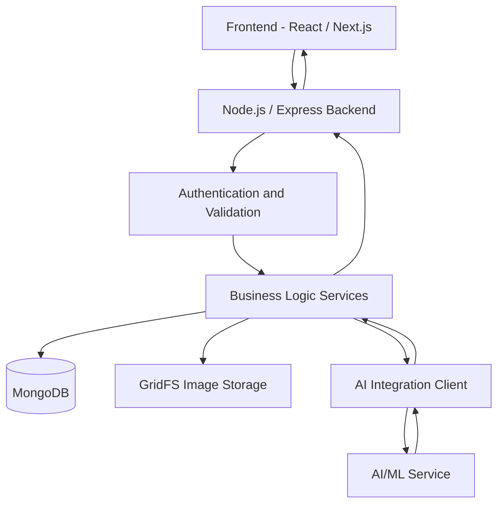
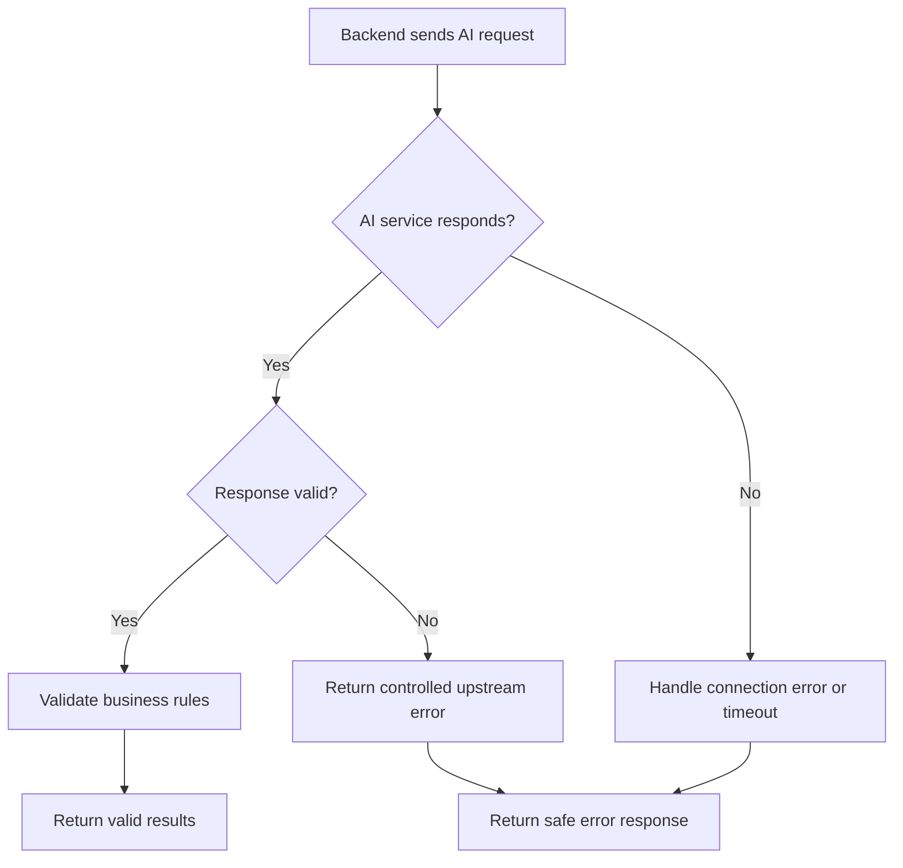

# AI Fashion Companion — Integration Flow

## 1. Overview

The AI Fashion Companion uses a Node.js/Express backend to connect the frontend, MongoDB database, GridFS image storage, and a separate AI/ML service.

The backend acts as the central coordinator. It validates requests, manages user data, communicates with AI models, validates AI results, and returns safe responses to the frontend.

## 2. System Architecture

## 3. Clothing Recognition Flow

The clothing recognition flow identifies clothing attributes from an uploaded image.

1. The user uploads a clothing image through the frontend.
2. The frontend sends the image to an authenticated backend endpoint.
3. The backend validates the user's access, file type, and image size.
4. The backend stores the image in GridFS when required.
5. The clothing recognition service prepares the image data or an authorized image URL.
6. The AI integration client calls `POST /recognize-clothing` on the AI service.
7. The AI service returns clothing predictions and confidence scores.
8. The backend validates the response using the wardrobe attribute schema.
9. Predictions below the configured confidence threshold are filtered out.
10. The backend returns the predictions and asks the user to confirm or edit the attributes.
11. After confirmation, the backend saves the approved clothing attributes to the user's wardrobe in MongoDB.

**Important:** The current recognition service returns predictions but does not automatically save wardrobe items. The upload, confirmation, and persistence steps must be connected through the appropriate controllers and services.

## 4. Outfit Recommendation Flow

1. The user requests outfit recommendations for an occasion or activity.
2. The backend authenticates the user and loads their wardrobe items from MongoDB.
3. The backend gathers available context, such as preferred styles, exclusions, weather, and previous outfits.
4. The backend sends the relevant data to the outfit recommendation AI service.
5. The AI service returns outfit combinations, explanations, and optional scores.
6. The backend validates that every recommended item belongs to the user's wardrobe.
7. The backend removes combinations containing excluded items, duplicate item IDs, or invalid item IDs.
8. The backend removes previously worn combinations when repetition avoidance is enabled.
9. The backend ranks valid recommendations by score.
10. The backend returns the remaining recommendations to the frontend.
11. If required by the product workflow, the backend stores the generated outfits and history in MongoDB.

The backend must never trust AI-generated item IDs without verifying ownership and validity.

## 5. Outfit Refinement Flow

1. The user views an outfit recommendation.
2. The user submits a refinement request, such as "Make it more formal" or "Avoid dark colors."
3. The backend validates the message and identifies the previous recommendations.
4. The refinement service prepares the message, preferences, exclusions, and recommendation context.
5. The backend sends the refinement request to the agreed AI endpoint.
6. The AI service returns updated suggestions.
7. The backend validates the suggestions against the user's wardrobe and preferences.
8. The backend returns the refined results to the frontend.
9. Conversation messages and refinement history may be stored in MongoDB when persistence is implemented.

The current refinement service only builds the payload; it does not yet call an AI endpoint or save conversation messages.

## 6. Data Responsibilities

| Component | Responsibility |
|---|---|
| Frontend | Upload images, display predictions, collect confirmation, and show recommendations |
| Express backend | Authentication, request validation, orchestration, business rules, and API responses |
| MongoDB | Store users, wardrobe metadata, preferences, outfits, and history |
| GridFS | Store clothing image files when this storage strategy is used |
| AI integration client | Communicate with the AI/ML service and validate its response format |
| AI/ML service | Perform clothing recognition and AI-generated outfit recommendations |

The backend is the source of truth for user ownership, saved wardrobe data, and persisted outfit history. The AI service provides predictions, not authoritative database records.

## 7. Error Handling Flow

The backend should handle:

- AI service timeouts.
- Network or connection failures.
- Non-success HTTP responses.
- Malformed JSON or invalid response schemas.
- Empty or low-confidence predictions.
- Outfit recommendations containing invalid, unowned, or excluded items.
- MongoDB or GridFS failures.

Errors returned to users should be clear and should not expose internal URLs, credentials, or stack traces.

## 8. Security and Privacy

- Protect user-specific operations with authentication and authorization.
- Validate uploaded file size, MIME type, and supported image formats.
- Avoid exposing private GridFS images through permanent public URLs.
- Send only the data required by the AI model.
- Never trust AI output as authorization or ownership evidence.
- Avoid logging image contents, access tokens, or sensitive personal information.
- Use HTTPS and appropriate service authentication in production.
- Apply rate limits to expensive AI operations.

## 9. Testing Strategy

### Unit tests

Test individual services independently:

- Clothing attribute validation.
- Minimum confidence filtering.
- Outfit validation and item ownership checks.
- Outfit ranking.
- Repetition avoidance.
- Refinement payload validation.

### Integration tests

Test interactions between backend components using mocked AI responses:

- Valid clothing recognition response.
- Invalid AI response.
- AI service unavailable.
- AI service timeout.
- Outfit recommendations containing unknown item IDs.
- Excluded items and duplicate item IDs.
- Previously worn outfit combinations.
- Empty or invalid refinement messages.

### End-to-end tests

Once the relevant routes and database operations are connected, test the full workflow:

1. Authenticate a user.
2. Upload a clothing image.
3. Review and confirm detected attributes.
4. Verify the saved wardrobe item.
5. Request outfit recommendations.
6. Verify ownership, exclusions, and repetition rules.
7. Refine a recommendation.
8. Verify that any saved history belongs to the correct user.

## 10. Implementation Status

The following components have been prepared in the current backend work:

- Shared AI request and response types.
- Clothing recognition HTTP client.
- Clothing prediction validation and confidence filtering.
- Outfit recommendation validation.
- Outfit ranking.
- Outfit repetition filtering.
- Refinement payload builder.
- AI integration and outfit recommendation test fixtures.
- Initial integration tests.
- API contract documentation.

The prepared services are not, by themselves, a complete end-to-end integration. Controllers, routes, database persistence, the production outfit recommendation client, and the refinement AI call must be connected where they do not already exist.

## 11. Dependencies on the AI/ML Team

Before production integration, confirm:

- The AI service base URL and deployment environment.
- Clothing recognition endpoint path and request format.
- Supported image formats and maximum image size.
- Prediction category values and confidence scale.
- Outfit recommendation endpoint and payload.
- Refinement endpoint and response format.
- Authentication, timeout, and error conventions.
- A stable test endpoint or mock responses for integration testing.

## 12. Completion Criteria

The integration is ready for acceptance testing when:

- [ ] Backend and AI/ML teams agree on the API contract.
- [ ] Environment variables are configured.
- [ ] Recognition responses are validated.
- [ ] Users can review predictions before wardrobe attributes are saved.
- [ ] Recommendations are checked against the user's actual wardrobe.
- [ ] Exclusions and repetition avoidance work correctly.
- [ ] AI failures return controlled errors.
- [ ] Tests pass locally and in CI.
- [ ] End-to-end workflows are tested before production release.
